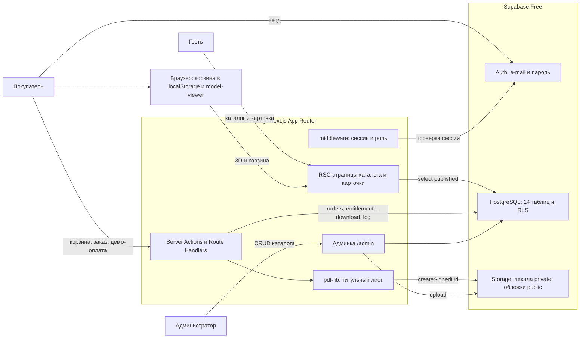
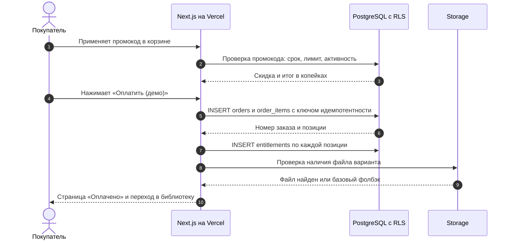
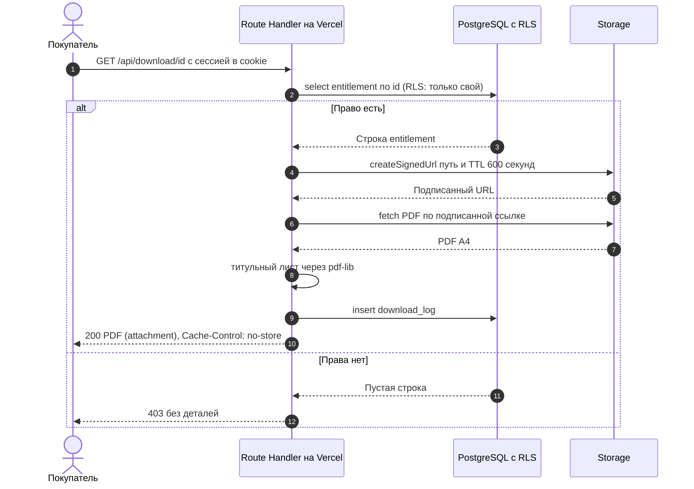

# SewIt — архитектура MVP

**Документ:** архитектура · **Версия:** 1.1 · **Дата:** 21.11.2026
**Статус:** ✅ approved · **Связанные документы:** [README.md](../README.md) (разделы 5–8), [tasks.MD](tasks.MD), [индекс документации](README.md)

---

## 1. Контекст и границы

SewIt — учебный MVP магазина готовых выкроек: пользователь находит модель, подбирает размер по меркам, настраивает пресет, «покупает» (демо-оплата) и скачивает PDF A4. Администратор управляет каталогом и файлами из UI.

**Акторы**

| Актор | Что делает | Ключевые требования |
|---|---|---|
| Гость | Смотрит каталог и карточку, собирает корзину | FR-1.*, FR-2.1–FR-2.4 |
| Покупатель | Регистрируется, вводит мерки, оформляет заказ, скачивает PDF | FR-3.*–FR-7.* |
| Администратор | CRUD выкроек, категорий, файлов, заказов, промокодов | FR-8.* |

**Внешние системы:** Supabase (PostgreSQL, Auth, Storage), Vercel (SSR, функции, CDN), GitHub (репозиторий, Actions). Платёжного провайдера нет — оплата эмулируется (README 2.4), e-mail-провайдера нет — письма идут через встроенный SMTP Supabase с ограничениями.

**Границы архитектуры**

* Внутри: веб-приложение на Next.js, схема БД и RLS, выдача файлов по подписанным ссылкам, админка, эмуляция оплаты, контентные и правовые страницы.
* Снаружи: реальный эквайринг и чеки 54-ФЗ, подписка и сертификаты, UGC и модерация, ателье, CAD-генерация лекал, 3D-примерка, форматы кроме PDF A4 — всё это Release 2+ (README 3.3).
* ❗Система не доверяет клиенту: цена, скидка, право на файл и роль пользователя определяются только на сервере и в БД.

---

## 2. Компоненты

Слои приложения: `app/` — маршруты и композиция; `components/` — UI (в том числе `components/ui` из shadcn/ui); `lib/` — бизнес-логика (`size-fit`, `variant`, `promo`, `pricing`, `entitlements`) и доступ к Supabase; `supabase/migrations` — схема и RLS как код; `doc/` — эта документация. Полное дерево — README 8.3.

---

## 3. Ключевые сценарии

### 3.1 Покупка: корзина → заказ → права

Инварианты сценария:

1. Цена и скидка пересчитываются на сервере; данные из `localStorage` считаются недоверенными.
2. Один `idempotency_key` = один заказ и один набор прав (FR-5.4).
3. `entitlements` создаются в той же транзакции, что и заказ: «оплачено» без прав невозможно.
4. Отсутствующий файл варианта не блокирует покупку: пишется фолбэк-пометка (FR-4.3).

### 3.2 Выдача PDF: entitlement → signed URL → download_log

Правила выдачи:

| Правило | Реализация | Требование |
|---|---|---|
| Файл не отдаётся напрямую | Бакет `patterns` приватный, публичного URL не существует | FR-7.1 |
| Право проверяется до подписи | Route handler: сессия → своя строка `entitlements` (RLS) → сверка `user_id`; чужая строка → 403 | FR-7.2 |
| Ссылка живёт 10 минут | `createSignedUrl(path, 600)`, значение из `DOWNLOAD_URL_TTL_SECONDS` | FR-7.1 |
| Каждое скачивание фиксируется | `insert into download_log` перед ответом с PDF | FR-7.3 |
| Титульный лист | `pdf-lib` собирает первую страницу с мерками и параметрами из заказа | FR-4.4 |

---

## 4. Модель данных и доступ

Схема — README 5 (14 бизнес-таблиц). Владелец данных — PostgreSQL; клиент не имеет прямого доступа к файлам лекал и не может выдать себе права.

### 4.1 RLS по таблицам

| Таблица | SELECT | INSERT | UPDATE / DELETE | Примечание |
|---|---|---|---|---|
| `profiles` | свой; admin — все | триггер на `auth.users` | свой (кроме `role`); admin — все | `role` меняется только через `service_role` |
| `measurements` | только свои | только свои | только свои | каскадное удаление с аккаунтом |
| `categories` | все | admin | admin | — |
| `patterns` | `published` — всем; admin — все | admin | admin | `draft` не виден ни в UI, ни в API |
| `pattern_sizes` | как `patterns` | admin | admin | читаются вместе с карточкой |
| `pattern_params` | как `patterns` | admin | admin | — |
| `pattern_files` | ❗только `service_role` | admin через Storage policy | admin | путь отдаёт сервер после проверки права |
| `orders` | свои; admin — все | сервер (`service_role`) | статус — admin | сумма считается на сервере |
| `order_items` | как `orders` | сервер | admin | — |
| `entitlements` | свои; admin — все | ❗только сервер | — | клиент не может выдать право |
| `download_log` | свои; admin — все | сервер | — | append-only |
| `favorites` | свои | свои | свои | unique (`user_id`, `pattern_id`) |
| `promo_codes` | admin | admin | admin | клиент не читает таблицу целиком |
| `instructions` | всем для `published` | admin | admin | — |

### 4.2 Storage

| Бакет | Публичность | Чтение | Запись | Что лежит |
|---|---|---|---|---|
| `covers` | public | все | admin / `service_role` | обложки и фото, WebP, 4:3 |
| `patterns` | ❗private | только `service_role` при подписи | admin / `service_role` | PDF A4 лекал, вариант-файлы |
| `models` | public | все | admin / `service_role` | `.glb` для 3D-витрины (не платный контент) |

---

## 5. Модель развёртывания

| Среда | Приложение | БД и Storage | Назначение | Данные |
|---|---|---|---|---|
| Локальная | `localhost:3000` | локальный Supabase в Docker | разработка, миграции, тесты | сид, сброс `supabase db reset` |
| Preview | Vercel preview | проект Supabase (тот же, что прод) | проверка PR | демо-данные |
| Production | Vercel, ветка `main` | Supabase `sewit-prod` | публичная ссылка и защита | демо-данные и заказы демо |
| Резерв | `localhost:3000` | локальный Supabase + `db dump` | защита при падении free tier | дамп перед демо |

Поток изменений: миграция в `supabase/migrations` → `db reset` локально → CI (`lint`, `typecheck`, `test`, `build`) → `supabase db push` в прод → деплой Vercel → смоук по README 13. Откат приложения — instant rollback в Vercel; отката миграций нет, поэтому миграция проверяется локально до `db push`.

---

## 6. ADR

### ADR-001. Next.js App Router вместо SPA

**Context.** Нужны SSR/ISR для SEO и LCP < 2,5 с (README 7), один разработчик, 10 дней, бесплатный хостинг.

**Decision.** Next.js 15+ с App Router и React Server Components; серверная логика — в Server Actions и Route Handlers.

**Consequences.** (+) Один язык и один деплой, каталог и карточка рендерятся на сервере, клиентский бандл меньше. (+) Превью-деплои и мгновенный откат на Vercel. (−) Привязка к App Router API и к Vercel-модели функций; смена major Next.js требует отдельного прогона CI.

### ADR-002. Supabase как BaaS вместо собственного бэкенда

**Context.** Нужны БД, авторизация, файлы и защита доступа; бюджет 0 ₽; один разработчик.

**Decision.** Supabase: PostgreSQL + Auth + Storage + RLS, доступ из `lib/supabase/*` на `@supabase/ssr`.

**Consequences.** (+) Три сервиса в одном, RLS вместо самописного слоя авторизации, SQL и миграции версионируются. (+) Бесплатный тариф покрывает учебные объёмы. (−) Пауза проекта при простое и лимиты egress. (−) `@supabase/ssr` до 1.0 — API cookie может меняться, поэтому версия фиксируется точно.

### ADR-003. Пресеты вместо параметрической CAD-генерации

**Context.** README 2.4: «генерация из мастер-модели» несовместима с 10 днями и 0 ₽.

**Decision.** Лекала отрисованы заранее под ограниченный набор комбинаций; система выбирает файл по `(size_id, variant_key)` и добавляет титульный лист.

**Consequences.** (+) Сценарий кастомизации работает за часы, а не месяцы. (+) Нет зависимости от CAD-библиотек и лицензий. (−) Комбинации ограничены; расширение требует новых файлов. (−) В UI нужна честная формулировка «варианты пресетов», иначе пользователь ждёт CAD.

### ADR-004. Только PDF A4 и `pdf-lib` для титульного листа

**Context.** В MVP один формат (README 2.4); любая серверная генерация ограничена лимитом функции.

**Decision.** Лекала — предзаготовленные PDF A4 в Storage; в рантайме генерируется одна страница титульного листа через `pdf-lib`.

**Consequences.** (+) Предсказуемая печать и контроль масштаба (тестовая страница 10×10 см). (+) Генерация укладывается в секунды и не зависит от headless-браузера. (−) A0/DXF/SVG и водяные знаки — Release 2. (−) Обновление лекал — ручная загрузка через админку.

### ADR-005. `entitlements` и signed URL как единственный путь выдачи

**Context.** Купленные файлы нельзя отдавать публично; лимит egress ограничен.

**Decision.** Право фиксируется в `entitlements`; файл отдаётся только по подписанной ссылке TTL 10 минут после серверной проверки; факт скачивания пишется в `download_log`.

**Consequences.** (+) Прямая ссылка на файл не работает, чужой `entitlementId` даёт 403. (+) Нет стриминга файлов через функцию — egress тратится только на реальные скачивания. (−) Ссылка живёт 10 минут: пользователю нужно скачивать сразу или запрашивать заново. (−) `pattern_files` недоступна клиенту даже на чтение — все пути отдаёт сервер.

### ADR-006. RLS как основной контур авторизации

**Context.** Нет отдельного бэкенда и нет ресурсов на самописную проверку прав в каждом запросе.

**Decision.** RLS включён на всех таблицах; политики описывают доступ по `auth.uid()` и `profiles.role`; `service_role` используется только в серверных модулях.

**Consequences.** (+) Ошибка в одном экране не открывает чужие данные: запрет на уровне БД. (+) Политики лежат в миграциях и проверяются `scripts/check-rls.sql`. (−) Отладка политик сложнее, чем проверок в коде. (−) `service_role` — критичный секрет: утечка обходит RLS полностью, поэтому ключ только на сервере и проверяется в CI.

### ADR-007. Корзина на клиенте

**Context.** Гость должен собирать корзину без регистрации (FR-5.1), сервер — источник истины по заказам.

**Decision.** Корзина в `localStorage` через `zustand`; на сервер уходит только оформленный заказ.

**Consequences.** (+) Нет гостевых сессий и миграции корзины при входе. (+) Корзина переживает закрытие браузера. (−) Цена в корзине может устареть — итог всегда пересчитывается на сервере. (−) Корзина не синхронизируется между устройствами.

### ADR-008. Vitest без E2E

**Context.** 10 дней, один разработчик, нет ревью; самое хрупкое — алгоритмы размера, вариантов и денег.

**Decision.** Юнит-тесты Vitest на чистые модули `lib/*`; сквозные сценарии — ручной смоук по README 13; RLS — SQL-чек-лист.

**Consequences.** (+) Тесты быстрые, без БД и сети, работают в CI. (+) Усилия идут в логику, а не в поддержку нестабильных E2E. (−) Регрессии в UI и в вёрстке ловятся только руками. (−) RLS и подписанные ссылки не покрыты автотестами — обязателен ручной сценарий перед деплоем.

---

## 7. Нефункциональные ограничения и деградации

| Ограничение | Значение | Деградация | Влияние на демо |
|---|---|---|---|
| LCP на 4G | < 2,5 с; бандл < 250 КБ | Скелетоны, ISR-кэш каталога, `next/image`, ленивый 3D | Сценарий не страдает |
| Лимит функции Vercel | Ограничение длительности | Никакой тяжёлой генерации: подпись URL и одна страница `pdf-lib` | Нет |
| Supabase Free, egress | ≈5 ГБ в месяц | PDF ≤ 0,5 МБ, обложки WebP, подписанные ссылки, кэш CDN | Нет при демо-объёме |
| Пауза проекта Supabase | ≈7 дней простоя | Баннер «сервис временно недоступен», пробуждение из дашборда, локальный фолбэк с дампом | До ~30 минут задержки |
| Встроенный SMTP Supabase | Мало писем в час | Сброс пароля может не дойти; в UI — «обратитесь к администратору» | Демо на письмах не построено |
| Нет `.glb` | 3D — stretch (P2) | Фото-галерея, 3D помечен как Release 2 | Шаг 2 демо без вращения |
| Нет файла варианта | Фолбэк по FR-4.3 | Базовый PDF + явная пометка в заказе | Заказ проходит |
| Нет контента для модели | Сокращение до 4 выкроек (README 9) | Каталог меньше, приёмка по п.3 нарушается — фиксируется письменно | Сценарий проходит |
| Один разработчик | Нет ревью и дежурного | `typecheck`, `lint`, Vitest в CI, фриз фич за день до защиты | Риск ошибки принимается |
| Сторонняя аналитика | ❗Запрещена | Метрики из `orders` и `download_log` | Нет |

---

## 8. Что архитектура сознательно не решает

* Реальный платёжный шлюз, чеки 54-ФЗ, возвраты — эмуляция с дисклеймером (README 2.4).
* Водяные знаки и DRM для PDF — Release 2.
* Масштабирование на несколько регионов, очереди, фоновые задания — учебные объёмы.
* Полноценная CAD-параметризация и 3D-примерка на аватаре — Release 2+.
* Модерация UGC, отзывы, ателье — вне MVP (README 3.3).

Любое расширение этих границ начинается с нового ADR в разделе 6 и пересчёта сметы в [tasks.MD](tasks.MD).
